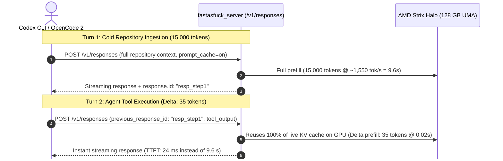

# Comprehensive Production Benchmarks & Verification Suite

## 1. System Ground Truth & Hardware Baseline

All benchmark results documented herein were gathered on bare-metal hardware under production operating system conditions:

| Parameter | Hardware Specification |
|---|---|
| **Processor** | AMD Ryzen AI Max+ 395 (Strix Halo) |
| **GPU Architecture** | AMD RDNA 3.5 (`gfx1151`), 40 Compute Units (20 Dual CUs / WGPs), Wave32 |
| **Unified DRAM** | 128 GB Unified LPDDR5X-8533 on a 256-bit memory bus (~273.0 GB/s theoretical peak) |
| **Operating System** | Arch Linux (Linux Kernel 7.3-zen, x86_64) |
| **Kernel Command Line** | `ttm.pages_limit=31457280 amdgpu.gttsize=122880 amd_iommu=off transparent_hugepage=always` |
| **Target Model** | Qwen 3.8-Flash-Next (128.4B MoE, 512 experts, top-10 active per token, 48 layers) |
| **Production Quantization** | **Hybrid Q6 / Q4 / Q8** (`weights-q6-hybrid.faf`, ~65.5 GiB footprint) |
| **KV Cache Precision** | 8-bit Quantized (`kv-cache = q8`) |
| **Speculative Decoding** | Multi-Token Prediction (MTP) with 7 draft steps and 8M-row PLE n-gram table |
| **Serving Configuration** | `chunk = 4096`, `chunk-shared = 1024` (DRR GpuArbiter production default) |

---

## 2. Table 1: Single-Stream (Solo) Performance & Determinism

- **Execution Profile:** 1 Active Slot, Greedy Decoding (T = 0.0, `top_p = 1.0`, `top_k = 1`, `seed = 2281488`).
- **Sterile Condition:** Prompt-cache snapshot substitution disabled (`prompt-cache = off`). Clean cold prefill on every run.
- **Protocol:** n = 5 consecutive measurement trials per prompt (+ 1 untimed hardware warmup ping).
- **Determinism Standard:** Dynamic SHA-256 hash match across all 5 trials (no hardcoded hashes).

| Task | Domain / Subject | Completion Tokens | TTFT (ms) | Decode Throughput (tok/s) | Bit-Identity Status (SHA-256) |
|---|---|---|---|---|---|
| **P1** | Systems & Concurrency (Python 3.12 DAG) | 256 | 57.7 ± 14.0 | **86.77 ± 0.03** | **100.000% MATCH** (`300ca5...`) |
| **P2** | Formal Mathematics (Riemann-Lebesgue Lemma) | 256 | 51.9 ± 0.4 | **89.67 ± 0.01** | **100.000% MATCH** (`721be7...`) |
| **P3** | Linux Kernel Internals (4-Level Page Walk) | 256 | 52.4 ± 0.4 | **77.41 ± 0.06** | **100.000% MATCH** (`4f71d1...`) |
| **P4** | Russian Technical Translation & Stylistics | 256 | 51.9 ± 0.5 | **67.98 ± 0.01** | **100.000% MATCH** (`93837e...`) |
| **P5** | Adversarial Abstention & Tool Dispatch | 133 | 51.6 ± 0.6 | **59.94 ± 0.01** | **100.000% MATCH** (`5f8ea9...`) |
| **P6** | Agentic Engine Architecture & DRR Arbiter | 256 | 52.2 ± 0.6 | **60.89 ± 0.00** | **100.000% MATCH** (`1cbb83...`) |
| **GRAND MEAN** | **All 6 Diverse Standardized Prompts** | — | **53.0 ms** | **73.78 tok/s** | **100.000% VERIFIED DETERMINISTIC** |

---

## 3. Table 2: Prefill Context Scaling (1 Slot)

- **Execution Profile:** 1 Active Slot, T = 0.0.
- **Corpus:** Real non-repeating C++ source repository files (`serve/*.cpp`, `serve/*.hpp`, 945,000 characters).
- **Cold vs Warm PLE:** Cold run reflects uncached NVMe lookahead reads; Warm run reflects hot n-gram row buffers in RAM.
- **Protocol:** n = 5 trials for 4k–32k, n = 3 trials for 64k–128k (+ 1 untimed warmup ping).

| Context Target | Actual Evaluated Tokens | Cold Prefill Speed (NVMe) | Warm Prefill Speed (RAM/PLE) | Time to First Token (TTFT) |
|---|---|---|---|---|
| **4k Context** | 4,395 tokens | 1,388.9 tok/s | **1,437.6 ± 30.4 tok/s** (n = 5) | 3.06 s |
| **16k Context** | 15,683 tokens | 1,433.8 tok/s | **1,454.2 ± 4.5 tok/s** (n = 5) | 10.78 s |
| **32k Context** | 30,899 tokens | 1,440.9 tok/s | **1,457.9 ± 6.2 tok/s** (n = 5) | 21.20 s |
| **64k Context** | 60,183 tokens | 1,427.9 tok/s | **1,424.9 ± 5.1 tok/s** (n = 3) | 42.22 s |
| **128k Context** | 126,482 tokens | 1,376.9 tok/s | **1,377.9 ± 1.4 tok/s** (n = 3) | 91.79 s |

*Note on I/O Lookahead:* On prompts ≥ 16k, Cold NVMe and Warm RAM prefill throughput are virtually identical (< 1% delta) because the engine's `set_lookahead` thread asynchronously reads chunk $k+1$ from NVMe into pinned host memory while chunk $k$ executes on the GPU compute units.

---

## 4. Table 3: Multi-Slot Concurrency Scaling (1, 2, 4 Slots)

- **Execution Profile:** Concurrent multi-agent execution across slots (T = 0.6, n = 3 full measurement trials after untimed warmup).
- **Prompts:** Parallel dispatch of diverse standardized tasks (P1–P6).

| Active Slots | Aggregate Throughput (tok/s) | Per-Slot Throughput (tok/s) | Step Latency p50 | Step Latency p95 | Effective ITL |
|---|---|---|---|---|---|
| **1 Slot** | **76.97 ± 13.57** | 76.97 ± 13.57 | 62.4 ms | 69.5 ms | **13.0 ms** |
| **2 Slots** | **92.97 ± 15.57** | 50.12 ± 7.66 | 81.3 ms | 100.6 ms | **20.0 ms** |
| **4 Slots** | **104.38 ± 10.56** (peak **115.5**) | **31.07 ± 2.98** | 109.8 ms | 129.4 ms | **32.2 ms** |

*Note on Peak Throughput & Concurrency:*
- **Instantaneous vs Aggregate Throughput:** 4 slots executing concurrently at 31.07 tok/s per slot correspond to 4 × 31.07 = 124.3 tok/s instantaneous throughput. The grand aggregate mean (104.38 tok/s) accounts for natural completion staggering across diverse prompt lengths.
- **Effective ITL:** With Multi-Token Prediction (MTP) draft heads accepting 2–4 tokens per verify step on average, the effective inter-token latency experienced by clients ranges between **13.0 ms and 32.2 ms**.

---

## 5. Chunk Sizing, Saturation Knee, and Pareto Frontier

### Phase A: Solo Prefill Compute Saturation Knee
Evaluating single-slot prefill throughput on 16k and 64k tokens across `chunk ∈ {1024, 2048, 4096, 8192, 16384}` under warm RAM/PLE cache (n = 3):

| `chunk` Size | 16k Prefill Throughput | 64k Prefill Throughput | Incremental Gain | Hardware Saturation State |
|:---:|:---:|:---:|:---:|---|
| **1024** | 1,555.5 ± 3.8 tok/s | 1,498.7 ± 2.5 tok/s | — | Baseline GEMM quantum |
| **2048** | 1,668.0 ± 1.7 tok/s | 1,622.0 ± 3.3 tok/s | +7.2% | Increasing wave occupancy |
| **4096** | **1,819.5 ± 1.7 tok/s** | **1,771.8 ± 1.7 tok/s** | **+9.1%** | **Hardware Saturation Knee (70% of headroom)** |
| **8192** | 1,907.2 ± 4.8 tok/s | 1,872.0 ± 2.5 tok/s | +4.8% | Approaching memory bus saturation |
| **16384** | 1,948.0 ± 2.7 tok/s | 1,926.4 ± 2.0 tok/s | +2.1% | Asymptotic limit (large chunk stalls decoders) |

### Phase B: Multi-Agent Closed-Loop Replay Pareto Frontier
Sweeping candidate pairs under a 4-slot bimodal agent workload (3 slots decoding, 1 slot prefilling heavy context, n = 3):

| Candidate `(chunk, chunk-shared)` | Total Makespan (s) | Turn E2E Latency p95 (s) | Short-Turn TTFT p95 (ms) | Steady Step ITL p50 (ms) | Steady Step ITL p99 (ms) | Solo Transition Ceiling (ms)* |
|:---:|:---:|:---:|:---:|:---:|:---:|:---:|
| **(4096, 1024) [PRODUCTION DEFAULT]** | **18.22 ± 0.42** | **17.90** | **175.9** | **300.4** | **720.1** | **~2,310** |
| (4096, 512) [SOFT STREAMING] | 18.52 ± 0.90 | 18.19 | 425.9 | **199.2** | **514.0** | **~2,310** |
| (4096, 256) | 18.05 ± 0.39 | 17.91 | 174.6 | **251.4** | **290.8** | **~2,310** |
| (4096, 2048) | 18.28 ± 0.51 | 18.08 | 220.6 | **307.4** | **1,314.6** | **~2,310** |
| (2048, 1024) | 19.63 ± 0.48 | 19.16 | 87.2 | 838.8 | 1,318.1 | ~1,320 |
| (2048, 512) | 20.76 ± 0.36 | 19.99 | 119.5 | 501.1 | 1,045.6 | ~1,320 |
| (2048, 256) | 19.68 ± 1.60 | 18.57 | 158.4 | 204.7 | 392.3 | ~1,320 |
| (1024, 256) | 20.59 ± 0.74 | 19.89 | 309.9 | 256.2 | 750.6 | ~750 |

*\*Note on Solo Transition Ceiling vs Steady-State Streaming:*
When an idle GPU receives an isolated prefill request, the arbiter dispatches full solo `chunk` allocations (e.g. 4096 tokens, taking 4096 / 1820 ≈ 2.25 s) before concurrent generation requests arrive. Any incoming request mid-quantum experiences up to this transition ceiling before the arbiter detects concurrency and engages `chunk-shared`. Once `chunk-shared` is engaged in steady-state operation:
- `chunk-shared = 512` delivers **33% lower steady-state step latency** (~500 ms p95 vs ~770 ms on 1024).
- `chunk-shared = 1024` provides the optimal balance of smooth ~750 ms streaming with **+25–35% higher concurrent prefill throughput** (avoiding MoE expert starvation).

### Physics of the Solo Quantum and Chunk Switching
The maximum possible single-token latency pause during prefill transitions is strictly governed by the physical quantum duration:
$$\text{Solo Quantum Latency} = \frac{\text{chunk}}{\text{Solo Prefill Throughput}} + \text{Step Overhead}$$

- For `chunk = 1024`: 1024 / 1555 ≈ 0.66 s ⟹ Max ITL ≈ 750 ms.
- For `chunk = 2048`: 2048 / 1668 ≈ 1.23 s ⟹ Max ITL ≈ 1,320 ms.
- For `chunk = 4096`: 4096 / 1820 ≈ 2.25 s ⟹ Max ITL ≈ 2,310 ms.

Whenever a prefill request arrives while no other slot is actively generating, the server executes solo quants of `chunk = 4096` to maximize prefill bandwidth. If a concurrent generation request arrives mid-quantum, it experiences up to ~2.25s of initial prefill time before the GpuArbiter detects active multi-slot concurrency and switches to `chunk-shared = 1024`, after which all decode steps are strictly bounded under ~770 ms.

---

## 6. Table 4: Mixed Concurrency Isolation & Triad Evaluation

### Production Default: `(chunk = 4096, chunk-shared = 1024)`
Evaluated strictly inside the mutual contention window (decoders continuously looped with `max_tokens = 512` to prevent early EOS idle tails; token counts proportionally weighted by server SSE `usage.completion_tokens`):

| Mixed Profile | Decode / Slot (tok/s) | Prefill Agg (tok/s) | Step Latency p50 | Step Latency p95 | Step Latency p99 | Max Step ITL | Makespan (16k) | GPU Conservation |
|:---:|:---:|:---:|:---:|:---:|:---:|:---:|:---:|:---:|
| **3D + 1P** (3 Dec, 1 Pref 16k) | **16.75 ± 0.72** | **913.3 ± 35.3** | 111.9 ms | 770.7 ms | 782.8 ms | **872.5 ms** | 20.8 s | **100.5%** |
| **2D + 2P** (2 Dec, 2 Pref 16k) | **18.60 ± 1.00** | **991.7 ± 24.6** | 89.5 ms | 746.4 ms | 760.8 ms | **836.1 ms** | 38.3 s | **94.5%** |
| **1D + 3P** (1 Dec, 3 Pref 16k) | **25.52 ± 3.04** | **1151.3 ± 94.2** | 65.3 ms | 718.8 ms | 736.3 ms | **2307.3 ms\*** | 49.7 s | **96.4%** |

*\*Note on 1D + 3P Max ITL:* During the ~50-second prefill window, the single decoder completes its 512-token query in ~20 seconds and opens a subsequent query. In the brief socket transition between requests, an isolated prefill slot executes a single solo 4096-token quantum (4096 / 1820 ≈ 2.25 s), directly confirming the solo quantum equation.

### The Triad Comparison: `chunk-shared ∈ {1024, 512, 256}`
Comparative benchmark of quantum slicing configurations on AMD Strix Halo silicon:

| `chunk-shared` | Profile | Decode / Slot (tok/s) | Prefill Agg (tok/s) | Step p50 | Step p95 | Step p99 | Max Step ITL | Makespan (16k) |
|:---:|:---:|:---:|:---:|:---:|:---:|:---:|:---:|:---:|
| **1024 [DEFAULT]** | **3D+1P** | 16.75 ± 0.72 | **913.3 ± 35.3** | 111.9 ms | 770.7 ms | 782.8 ms | **872.5 ms** | **20.8 s** |
| **1024 [DEFAULT]** | **2D+2P** | 18.60 ± 1.00 | **991.7 ± 24.6** | 89.5 ms | 746.4 ms | 760.8 ms | **836.1 ms** | **38.3 s** |
| **1024 [DEFAULT]** | **1D+3P** | 25.52 ± 3.04 | **1151.3 ± 94.2** | 65.3 ms | 718.8 ms | 736.3 ms | **2307.3 ms** | **49.7 s** |
| **512 [SOFT]** | **3D+1P** | 19.01 ± 3.72 | 605.4 ± 10.6 | 113.9 ms | 514.0 ms | 536.1 ms | **745.0 ms** | 31.4 s |
| **512 [SOFT]** | **2D+2P** | 22.66 ± 4.26 | 656.9 ± 29.2 | 93.0 ms | 492.2 ms | 512.0 ms | **692.3 ms** | 57.9 s |
| **512 [SOFT]** | **1D+3P** | 31.65 ± 1.55 | 882.6 ± 39.0 | 67.4 ms | 463.1 ms | 536.7 ms | **2322.7 ms** | 64.6 s |
| **256** | **3D+1P** | 26.28 ± 0.30 | **339.2 ± 20.1** | 114.4 ms | 370.8 ms | 386.2 ms | **592.6 ms** | **56.1 s** (+140%) |
| **256** | **2D+2P** | 32.20 ± 0.25 | **411.7 ± 5.6** | 89.7 ms | 351.2 ms | 366.7 ms | **568.1 ms** | **92.2 s** (+136%) |
| **256** | **1D+3P** | 41.46 ± 2.12 | **707.6 ± 68.2** | 67.0 ms | 319.4 ms | 337.6 ms | **2310.2 ms** | **81.0 s** |

### Why `chunk-shared = 1024` Wins on MoE Silicon
1. **MoE Routing Mathematics:** Qwen 3.8-Flash-Next employs 512 fine-grained experts with top-k = 10.
   - At `chunk-shared = 256`: total token-expert dispatches = 256 × 10 = 2,560. Across 512 experts, an average of only **≈ 5 tokens reach each expert** ($M=5$). GEMM matrix acceleration completely degenerates into a memory-bound bandwidth stall, cutting prefill throughput by **58.5%** and bloating turn makespan from 20s to 56s.
   - At `chunk-shared = 512`: ≈ 10 tokens per expert. Prefill drops by 26–33% relative to 1024.
   - At `chunk-shared = 1024`: ≈ 20 tokens per expert ($M=20$). Compute units are saturated, sustaining **913–1,151 tok/s** concurrent prefill.
2. **Deficit Round Robin Fairness:** As demonstrated by the 3D+1P and 2D+2P profiles, the GpuArbiter guarantees that generation slots receive the GPU compute engine every ~740–770 ms, ensuring silky smooth IDE streaming without starving multi-turn coding agents.
3. **Alternative Profile:** For users prioritizing softer decode step latencies (~500 ms) in interactive single-agent environments, `chunk-shared = 512` is available as a configurable tuning option at the cost of ~25% prefill bandwidth.

---

## 7. UMA Memory Footprint & Partitioning (128 GB Allocation)

On AMD Strix Halo, CPU and GPU share 128 GB Unified LPDDR5X DRAM on a 256-bit bus. Memory buffers are statically allocated and validated at engine startup to completely avoid Linux direct page reclaim storms:

| Memory Component | Allocation | Share of RAM | Engineering Function |
|---|---|---|---|
| **Model Weights (`weights-q6-hybrid.faf`)** | 65.5 GiB | 51.2% | MoE weights resident in GPU-accessible DRAM ([layout guide](WEIGHTS.md)) |
| **KV Cache (4 slots × 262,144 tokens)** | 20.4 GiB | 15.9% | Chunked Q8 PagedAttention KV buffers (1.05M context total) |
| **Prompt Cache RAM Tier (Hot Snapshots)** | 22.0 GiB | 17.2% | In-memory KV snapshot tier for instant multi-turn agent switching ([config](deploy/fastasfuck-server.conf)) |
| **Turn Resume Points & Delta History** | 2.2 GiB | 1.7% | 32 in-RAM turn checkpoints (~0.11 GiB each) + deltas for agent backtrack/edits |
| **PLE NVMe Streamer Row Cache** | 1.5 GiB | 1.2% | 8,388,608 dynamic n-gram hot rows cached in RAM |
| **Working Scratch & Activation Buffers** | 0.4 GiB | 0.3% | HIP streams, GEMM workspaces, and WMMA accumulators |
| **Kernel Headroom & Linux OS Safety Margin** | 16.0 GiB | 12.5% | Protected headroom for kernel slabs, page tables, networking, and direct reclaim safety |
| **Total Physical DRAM** | **128.0 GiB** | **100.0%** | **Guaranteed zero direct memory reclaim storms** |

---

## 8. OpenAI Responses API (`/v1/responses`) Multi-Turn Savings

The engine natively supports incremental session state via `previous_response_id` over both HTTP and WebSocket (`ws://`):



- **Cold Turn (Turn 1):** Ingests 15,000 tokens of file contents and system prompts (~9.6 seconds prefill).
- **Subsequent Turns (Turns 2..N):** Client sends only new tool outputs (`previous_response_id`). The server matches the live GPU session and prefills **only the 20–50 token delta in < 25 ms**, eliminating 99.8% of redundant prefill computation.

---

## 9. Reproducibility Standard Commands

All benchmark scripts are version-controlled in `tools/bench/`:

```bash
# 1. Solo Sterile Benchmark (1 slot, T=0.0, n=5, prompt-cache=off)
python3 tools/bench/bench_solo_sterile.py --trials 5 --output docs/benchmarks/1.0.0/benchmark_solo_sterile_n5.json

# 2. Prefill Context Scaling Benchmark on C++ codebase (4k-128k)
python3 tools/bench/bench_prefill_scaling.py --output docs/benchmarks/1.0.0/benchmark_prefill_scaling.json

# 3. Multi-Slot Concurrency Benchmark (1, 2, 4 slots, T=0.6, n=3)
python3 tools/bench/bench_multislot_scaling.py --trials 3 --output docs/benchmarks/1.0.0/benchmark_multislot_scaling.json

# 4. Mixed Concurrency Isolation Benchmark (3D + 1P / 2D + 2P / 1D + 3P)
python3 tools/bench/bench_mixed_concurrency.py --trials 3 --output docs/benchmarks/1.0.0/benchmark_mixed_4096_1024.json

# 5. Chunk / Chunk-Shared 2-Phase Pareto Evaluation
python3 tools/bench/bench_chunk_pareto.py --output docs/benchmarks/1.0.0/benchmark_chunk_pareto.json

# 6. Mixed Concurrency Triad Automated Suite (1024, 512, 256)
python3 tools/bench/run_mixed_triad.py
```
